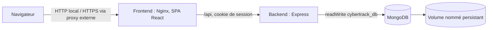

# CyberTrack

CyberTrack est une application de gestion des vulnérabilités destinée au suivi
des actifs, des scans enregistrés et des actions de remédiation. Le projet
combine une API REST Node.js/Express, une base MongoDB existante et une
interface React responsive.

> Les jeux de données marqués `CYBERTRACK_SIMULATED` sont des données de
> démonstration, pas des avis CVE authentiques. CyberTrack n'exécute pas de
> scan réseau : l'API permet de consulter et d'enregistrer des résultats de
> scan/import.

## Fonctionnalités présentes

- Authentification par mot de passe bcrypt et cookie JWT HttpOnly.
- Rôles `ADMIN`, `SECURITY_ANALYST` et `VIEWER`, avec protection des routes.
- Gestion paginée des vulnérabilités, actifs, utilisateurs, scans et tâches.
- Filtres de sévérité, statut, CVSS, date, environnement, rôle et priorité.
- Tableau de bord alimenté par les agrégations MongoDB du serveur.
- Import explicite des CVE depuis l'API officielle NVD 2.0, avec pagination,
  reprises des erreurs transitoires et protection des enregistrements
  `CYBERTRACK_SIMULATED`.
- Fiches vulnérabilité/asset avec scans, constats et tâches associés.
- Historique de remédiation généré côté serveur; `completedAt` est maintenu
  lors des transitions vers/hors `COMPLETED`.
- Contrôle des références avant suppression, validation des entrées, limites
  de requêtes, Helmet, CORS et réponses d'erreur cohérentes.
- Interface SOC sombre en français avec recherche, filtres, pagination,
  formulaires CRUD, sélecteurs recherchables pour les actifs, vulnérabilités
  et assignés, et consultation des détails.
- Tests frontend du tableau de bord, de la navigation et du parcours de création
  d'une tâche avec sélection de références; tests d'intégration API sur base isolée.

## Architecture et données



```text
client/                 React 19 + Vite; image de production servie par Nginx
server/
  config/               configuration MongoDB et authentification
  controllers/          logique des ressources, filtres et agrégations
  middleware/           authentification, rôles, origine, erreurs, sécurité
  models/               schémas Mongoose
  routes/               routes Express sous /api
  database/             index, validation, laboratoire et vérification
  tests/                test d'intégration API isolé
docker/                 Initialisation idempotente du compte MongoDB applicatif
docker-compose.yml      MongoDB, initialiseur, API et interface Nginx
.github/workflows/ci.yml CI des tests, de Compose et du parcours conteneurisé
```

**Technologies :** React 19, Vite, Nginx, Node.js 24, Express 5, Mongoose 9,
MongoDB 7, Docker Compose et GitHub Actions.

La base garde ses cinq collections historiques :

| Collection | Données principales | Relations |
|---|---|---|
| `vulnerabilities` | CVE, description, CVSS, sévérité, dates, références | Référencée par les résultats et tâches |
| `assets` | hôte, IP, système, environnement, criticité | Référencée par les scans et tâches |
| `users` | identité, rôle, département, statut | Référencée comme opérateur, assigné ou créateur |
| `scans` | état, dates et résultats | `results` est embarqué; références vers asset, utilisateur et vulnérabilité |
| `remediation_tasks` | priorité, statut, échéance et historique | `history` est embarqué; références vers vulnérabilité, asset et utilisateurs |

Les contrôleurs emploient des filtres validés et des agrégations MongoDB pour
les indicateurs. Les index existants couvrent notamment `cveId`, sévérité,
CVSS, date de publication et les références de scans/tâches. Un index multikey
`scans.results.vulnerabilityId` couvre aussi les nouvelles vues de relations.
Pour conserver les données, les scripts `db:indexes` et `db:validation` sont des opérations
explicites; le serveur désactive la création automatique des index.

## Prérequis et lancement local

- Node.js 24.
- MongoDB Community accessible, avec la base `cybertrack_db` et les cinq
  collections requises. Le projet ne relance pas automatiquement le seed.

Depuis la racine, installer les dépendances :

```powershell
Set-Location .\server
npm ci
Set-Location ..\client
npm ci
```

Configurer `server/.env` à partir de `server/.env.example`. Renseigner une URI
MongoDB qui cible `cybertrack_db`, puis remplacer le secret JWT par une valeur
aléatoire d'au moins 32 octets. Ne publiez pas les fichiers `.env`.

Démarrer l'API et Vite dans deux terminaux :

```powershell
Set-Location .\server
npm run dev
```

```powershell
Set-Location .\client
npm run dev
```

L'interface est disponible à `http://127.0.0.1:5173` et l'API à
`http://127.0.0.1:5000`. Vite relaie `/api` vers l'API locale. La route
`GET /api/health` vérifie la connexion MongoDB. Créer ou promouvoir un compte
administrateur volontairement avec `npm run auth:bootstrap` et les variables
`BOOTSTRAP_ADMIN_*`; consulter la procédure PowerShell dans
[`server/docs/API_DOCUMENTATION.md`](./server/docs/API_DOCUMENTATION.md).

### Compte analyste de démonstration (développement uniquement)

La base de développement contient un compte au rôle `ANALYST`; son
adresse est remplacée ici par l'adresse fictive `analyst@example.com`. Son mot de passe de démonstration est conservé localement dans
`server/.env`, sous `CYBERTRACK_DEMO_ANALYST_PASSWORD`; il n'est volontairement
pas inclus dans cette documentation versionnée ni dans le modèle `.env.example`.
Ce compte et ce mot de passe sont réservés au développement local : ne les
réutilisez pas dans un environnement partagé ou de production.

## Docker Compose

Prérequis : Docker Desktop avec le moteur Linux et Docker Compose v2, ou Docker
Engine avec le plugin Compose. Depuis la racine du projet, copier le modèle
Compose et remplacer tous les placeholders par des valeurs fortes et uniques :

```powershell
if (-not (Test-Path .env)) { Copy-Item .env.example .env }
```

Les mots de passe MongoDB doivent être URL-safe (par exemple des chaînes
hexadécimales aléatoires), car le compte applicatif est transmis via une URI.
Le secret JWT doit comporter au moins 32 octets.

Si vous mettez à niveau un ancien fichier `.env`, conservez ses identifiants
racine (ils correspondent au volume existant) et ajoutez les deux variables
`MONGO_APP_USERNAME` et `MONGO_APP_PASSWORD` du nouveau modèle. Avant de
démarrer avec les nouveaux noms de services, arrêtez et retirez les anciens
conteneurs orphelins sans supprimer le volume :

```powershell
docker compose down --remove-orphans
```

Démarrer l'application :

```powershell
docker compose up -d --build
docker compose ps
```

L'interface est disponible à `http://127.0.0.1:5173`. Nginx sert les fichiers
statiques et relaie `/api` vers l'API interne. MongoDB et l'API ne publient
aucun port sur l'hôte. Les services utilisent un réseau Compose privé; seul
le port local de l'interface est publié.

Les services ont des contrôles de santé et des dépendances de démarrage :

- `mongodb` utilise l'image officielle MongoDB et le volume nommé
  `cybertrack_mongo_data`.
- `mongodb-init` crée un compte doté de `readWrite` sur `cybertrack_db` seulement
  s'il n'existe pas déjà; un compte existant, son mot de passe et ses rôles
  restent inchangés.
- `backend` exécute Express sous l'utilisateur non-root `node`, attend
  MongoDB et l'initialiseur, puis expose `/api/health` au réseau Docker.
- `frontend` construit React avec Vite puis sert la SPA depuis Nginx non-root.
  Nginx relaie aussi les requêtes `/api` vers `backend`.

Commandes courantes :

```powershell
docker compose logs -f
docker compose logs -f backend
docker compose restart backend
docker compose down
```

`docker compose down` conserve le volume et les données. Ne pas utiliser
`docker compose down -v` dans un workflow normal. Garder les mêmes identifiants
racine MongoDB pour un volume déjà initialisé. Les collections applicatives ne
sont pas seedées automatiquement.

Compose configure `TRUST_PROXY_HOPS=1`. Nginx transmet le protocole fourni par
un proxy amont fiable; le cookie JWT reste `HttpOnly` et `SameSite=Strict`, et
son attribut `Secure` suit le protocole réel. Le Compose fourni sert en HTTP
uniquement sur la boucle locale pour le développement. Pour un déploiement
public, terminer TLS sur un proxy de confiance, transmettre
`X-Forwarded-Proto: https`, configurer `CORS_ORIGIN` avec l'origine réelle et
ne pas publier directement l'API ou MongoDB. Aucun certificat TLS ni
déploiement public n'est inclus.

Créer explicitement un administrateur pour le Compose local, si nécessaire :

```powershell
docker compose exec `
  -e BOOTSTRAP_ADMIN_EMAIL=admin@example.test `
  -e BOOTSTRAP_ADMIN_PASSWORD=REPLACE_WITH_A_UNIQUE_LOCAL_PASSWORD `
  backend npm run auth:bootstrap
```

Cette commande crée ou promeut le compte indiqué; ne la lancez pas contre un
compte ou une base que vous ne souhaitez pas modifier.

Les appels du frontend restent relatifs à `/api`; aucune URL ou clé secrète
n'est intégrée dans les variables `VITE_*`. En développement local hors Docker,
Vite relaie `/api` vers `http://127.0.0.1:5000`; ce proxy n'est pas inclus dans
l'image de production.

## Vérification

```powershell
Set-Location .\server
npm test
npm run db:verify
Set-Location ..\client
npm test
npm run lint
npm run build
```

Les tests API utilisent une base au nom aléatoire et comparent l'état de la
base configurée avant/après. La CI crée uniquement les cinq collections vides
requises dans son service MongoDB avant d'exécuter les tests. La vérification
`db:verify` s'exécute contre la base locale configurée et mesure notamment les
plans `COLLSCAN` et `IXSCAN`; elle ne modifie pas les documents existants.

Vérifications effectivement exécutées localement pendant cette livraison :

- API : `npm test` a réussi (5 tests), dont les tests d'intégration CRUD,
  rôles, filtres, agrégations, références, historique de remédiation et les
  tests unitaires de pagination/reprise NVD.
- Frontend : `npm test` a réussi (3 tests); `npm run lint` et
  `npm run build` ont réussi.
- Docker Compose : `docker compose config --quiet` a réussi avec des variables
  de validation temporaires.
- Docker : le client Docker 29.6.1 est installé, mais Docker Desktop n'était
  pas démarré (pipe `dockerDesktopLinuxEngine` absent). Les images et
  conteneurs n'ont donc pas été construits ou démarrés localement.

Vérifications précédentes du projet :

- MongoDB : cinq collections conformes, 10 001 vulnérabilités; l'exemple réel
  testé a examiné 10 001 documents avec `COLLSCAN` contre 1 073 documents et
  1 073 clés avec `IXSCAN` (`severity_index`). Les temps mesurés lors de la
  dernière exécution étaient respectivement 7 ms et 3 ms; ce ne sont pas des garanties
  de performance.
- Dépendances : `npm audit --audit-level=high` n'a signalé aucune vulnérabilité
  dans les manifests backend et frontend au moment de ce contrôle antérieur.

## API

Les routes métier sont sous `/api` et nécessitent une authentification, sauf
`/api/health` et les routes de session :

| Préfixe | Opérations |
|---|---|
| `/api/auth` | connexion, déconnexion, utilisateur courant |
| `/api/vulnerabilities` | CRUD, recherche, filtres et statistiques |
| `/api/assets` | CRUD, recherche et filtres |
| `/api/users` | CRUD administrateur, sans exposition du hash |
| `/api/scans` | CRUD, filtres et résultats associés |
| `/api/remediation` | CRUD, historique et filtres |
| `/api/dashboard` | synthèse, sévérités/statuts, tendances, scans et classements |

La documentation de requêtes, paramètres et formats est dans
[`server/docs/API_DOCUMENTATION.md`](./server/docs/API_DOCUMENTATION.md).

## Sécurité et limites

Les paramètres MongoDB ne sont jamais construits directement à partir
d'opérateurs utilisateur; les contrôleurs n'acceptent que des champs connus.
Les recherches textuelles échappent les expressions régulières. Les secrets
ne sont pas versionnés, les réponses ne contiennent pas `passwordHash`, et les
erreurs internes n'exposent pas de stack trace en HTTP.

Cette version ne fournit pas de moteur d'analyse réseau ni de système d'audit
séparé. L'import NVD est manuel et n'a pas été exécuté contre l'API distante
pendant cette livraison. Les vues de relations sont limitées aux 100 entrées
les plus pertinentes. Les résultats d'un scan restent saisis comme JSON et ne
disposent pas de sélecteur dédié pour chaque vulnérabilité. Le rapport PDF et
la préparation de soutenance sont des livrables
documentaires, pas des fonctions générées par l'application.

## CI et publication

Le workflow GitHub Actions est configuré pour exécuter les tests backend et
frontend, Oxlint, le build frontend, les audits npm et `docker compose config`.
Il doit construire puis démarrer le stack Compose avec des secrets temporaires
générés dans le job et vérifier les contrôles de santé, l'accès frontend, la
connexion/cookie JWT, le proxy vers l'API et la conservation d'un document
témoin après redémarrage de MongoDB. Il n'a pas été exécuté dans le cadre de
cette vérification locale; ces résultats restent à confirmer par une exécution
GitHub Actions. Le nettoyage CI utilise `docker compose down` sans supprimer
explicitement le volume. Aucun déploiement automatique n'est configuré :
construire et tester des images ne constitue pas un déploiement. Le dépôt ne
doit pas recevoir de `.env`, `node_modules`, données de production ou secrets.

## Présentation académique et portfolio

- [Rapport académique (PDF, 5 pages)](./RAPPORT.pdf)
- [Source HTML du rapport](./server/docs/RAPPORT_SOURCE.html)
- [Questions et scripts de soutenance](./server/docs/DEFENSE_ORALE.md)
- [Documentation détaillée de l'API](./server/docs/API_DOCUMENTATION.md)

**Description du dépôt :** plateforme de gestion des vulnérabilités avec
inventaire d'actifs, suivi de remédiation, agrégations MongoDB et interface
React.

**Résumé CV :** Conception d'une plateforme de gestion des vulnérabilités avec
API REST Express/Mongoose, authentification par rôles, tableau de bord React,
tests d'intégration isolés et workflow Docker/CI.

**Résumé LinkedIn :** CyberTrack est un projet académique de gestion des
vulnérabilités et de suivi de remédiation. Il met en œuvre une API Node.js,
MongoDB, une interface React responsive, des contrôles d'accès par rôles, des
agrégations serveur et une chaîne de vérification automatisée. Les scans sont
des résultats enregistrés/importés; aucun moteur réseau n'est revendiqué.
